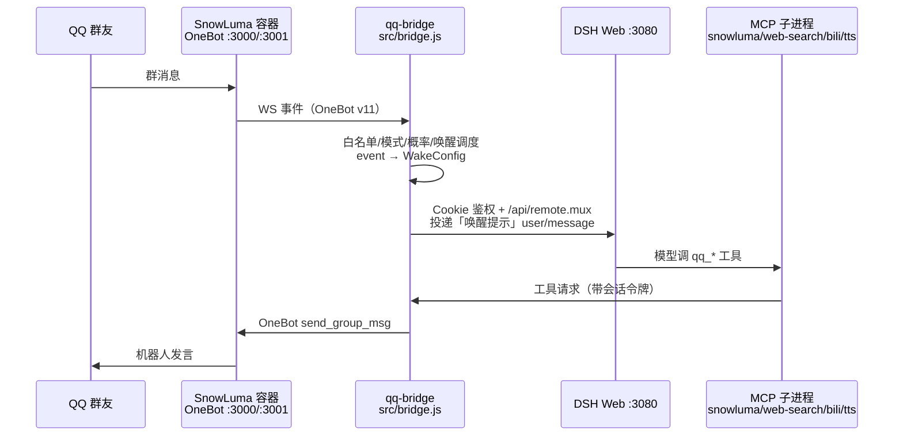

# QQ Bridge 交接文档（Agent 运维版）

> **快照时间**：2026-10-26 16:50 CST（所有数字都是这一刻在服务器上实测的）
> **读者**：接手这套 QQ ↔ DSH 机器人栈的 AI agent
> **定位**：`/root/qq-bridge/docs/README.md` 是仓库的权威文档索引（含 113KB 的 `guides/PROJECT_GUIDE.md`）。
> 本文不重复那些内容，只回答四个问题：**东西在哪、怎么跑起来、怎么改、怎么查坏在哪**。

---

## 0. 30 秒速览

| 组件 | 版本 | 位置 | 端口 | 单元 |
| --- | --- | --- | --- | --- |
| qq-bridge（你主要维护的东西） | `0.2.1-r1`（git `36fa2b6`） | `/root/qq-bridge` | 3100（控制台，仅回环） | `qq-bridge.service` |
| DSH Web | `0.2.1-rc.2` | `/root/.dsh/profiles/web` | 3080（仅回环） | `dsh-web.service` |
| dsh-jump（免 token 跳板） | 4,074 B 脚本 | `/usr/local/bin/dsh-jump.js` | 18080（仅回环） | `dsh-jump.service` |
| SnowLuma（QQ 客户端） | `2.2.0`（容器） | `/root/snowluma`（compose） | 3000 OneBot HTTP / 3001 OneBot WS / 5099 WebUI / 6081 noVNC | Docker `snowluma` |
| billion-context（上下文压缩） | `0.1.206` | profile 依赖 | `/_bili/*` 走 18080 反代 | — |
| Node | `v24.21.0` | `/root/.nvm/versions/node/v24.21.0` | — | — |

宿主机：腾讯云 `VM-0-11-ubuntu`，`193.112.27.92`，Ubuntu 22.04.5，kernel 5.15.0-198-generic，
40G 盘用了 22G（58%），3.7G 内存用 2.2G，uptime 17 天。

**当前业务状态**：`reserved2`（二代仿真）模式，角色卡 `小鲸鱼`，白名单群 `644343678`、白名单私聊 `1353061595`，
两条 DSH 会话映射齐全，四个定时任务在跑。

---

## 1. 怎么进去

```bash
ssh qq                     # 已配好免密，ubuntu 用户，sudo 免密
sudo -i                    # 所有运维操作都在 root 下做
```

所有 Web 端口都只绑 `127.0.0.1`，**服务器上没有 nginx/caddy**，对外一律走 SSH 隧道：

```bash
ssh -N -L 18080:127.0.0.1:18080 qq
# 然后本机浏览器：
#   http://127.0.0.1:18080/         → 302 到 DSH Web（dsh-jump 每次请求重新解 token）
#   http://127.0.0.1:18080/bridge   → 302 到 QQ 桥接控制台
#   http://127.0.0.1:18080/__bili/… → billion-context
```

令牌都在磁盘上，**只读不打印**：

| 令牌 | 文件 | 说明 |
| --- | --- | --- |
| 控制台令牌 | `/root/qq-bridge/state/console-token` | 48 字节十六进制；HTTP 头 `x-console-token` 或 `?token=` |
| SnowLuma OneBot token | `/root/snowluma/data/config/onebot_2178668510.json` | HTTP(43 字符) 与 WS 各一个 |
| DeepSeek API Key | `/root/.dsh/.credentials.yaml` | `DEEPSEEK_API_KEY`，35 字符，`sk-3d…` |
| DSH Cookie | 由 qq-bridge 离线铸造 | 见 `src/dsh-client.js`，别手搓 |

控制台鉴权有两个条件同时成立：`Host` 必须是 `127.0.0.1:3100`，且带 `x-console-token`。

---

## 2. 消息是怎么流的



关键设计（不懂这三点会一直改错地方）：

1. **「一切皆工具」**：`reserved2` 模式下 agent 的文本输出**不会**自动发到 QQ，必须显式调
   `qq_send_message` / `qq_reply` / `qq_send_burst` 等工具。文本只进 DSH，工具才出网。
2. **唤醒提示是每回合注入的 `user/message`**，不是 system prompt。它在
   `src/bridge.js` 的 `buildWakePromptBodyV2()` 里拼；角色卡在注入时被包进同一段（上限
   `role.maxInjectChars = 10000`）。所以「改角色卡」= 改唤醒提示的一部分。
3. **MCP server 是 dsh-web 的子进程**，不是 bridge 的子进程。改 `src/mcp-*.js` 必须重启
   `dsh-web` 才会生效；改 `src/bridge.js` 只需重启 `qq-bridge`。

---

## 3. 目录地图（只列要动手的）

```
/root/qq-bridge/
├── src/
│   ├── bridge.js            12,286 行 —— 主程序：OneBot 接入、唤醒调度、控制台 HTTP、qq_* 工具、DSH 投递
│   ├── dsh-client.js          978 行 —— DSH 的 Cookie 鉴权 / 斜杠 RPC / remote.mux 事件流
│   ├── token-ledger.js        958 行 —— 令牌与花费账本（写 state/token-usage.jsonl）
│   ├── mcp-snowluma-safe.js 1,408 行 —— QQ 收发工具面（qq_* 全部在这里）
│   ├── mcp-host-server.js           —— 宿主侧工具（进程/文件等受控能力）
│   ├── mcp-web-search-safe.js       —— 联网搜索（360资讯/搜狗/Bing 三通道 + DeepSeek 通道）
│   ├── mcp-bili-digest.js           —— billion-context 摘要/归档
│   ├── mcp-tts-voice.js             —— 语音合成 + 发送
│   ├── media-normalize.js / sticker-lib.js / voice-core.js / slang-learner.js
│   └── model-prices.js               —— 计价表（峰谷分时）
├── dsh/agent-presets/
│   ├── qq-chat/agent.cordis.yml      —— 一代 preset（chat/reserved 模式用）
│   └── qq-chat-v2/agent.cordis.yml   —— 二代 preset（reserved2 用，24.7KB，工具清单+提示在这里）
├── plugins/
│   ├── qq-agent-presets/qq-tool-restrict.mjs  —— 安全守卫：把危险工具从 agent 视野里摘掉
│   └── qq-agent-presets/presets/*.patch.yml   —— **生成物**，勿手改
├── roles/
│   ├── 小鲸鱼.md（14.7KB，现役角色卡）
│   ├── README.md（角色卡规范）
│   └── _archive/（历史版本，未入库）
├── scripts/                 —— setup-dsh.mjs（安装到 DSH）、build-agent-preset-patches.mjs（生成 patch）、
│                               test-*.mjs（回归）、probe-*.mjs（协议探针）、qq-*-check/diagnose
├── state/                   —— 运行态（会话映射、模式、角色、黑话、账本、日志、锁）
├── config.json              —— 全部可调参数（6.9KB，600 权限）
├── docs/                    —— 权威文档；guides/PROJECT_GUIDE.md 是总说明书
├── RULES.md                 —— 四模式与权限边界的**定义**（改权限前先读）
└── public/console.html      —— 控制台前端

/root/.dsh/                  —— DSH 数据根（凭据、会话、preset、profile）
├── profiles/web/{package.json,cordis.patch.yml}  —— 插件/MCP 的挂载点
├── plugins/{qq-agent-presets -> /root/qq-bridge/plugins/qq-agent-presets, qq-mode-console -> …, qq-bartender-preset}
├── memory/MEMORY.md         —— dsh-memory 的跨会话记忆（9.5KB，agent 自己写）
└── sessions/                —— 42 个会话目录（别手动删）

/root/snowluma/              —— docker-compose.yml + data/（QQ 登录态、OneBot 配置、ui.json）
/usr/local/bin/qq-backup.sh / qq-restore.sh / qq-watchdog.sh / qq-cost-report.mjs / dsh-jump.js
```

---

## 4. 配置分五层，改之前先确认改哪一层

| 层 | 文件 | 管什么 | 生效方式 |
| --- | --- | --- | --- |
| ① 桥接参数 | `/root/qq-bridge/config.json` | 白名单、概率、节奏、限流、语音、贴纸、黑话、计价、consolePort、dsh.model/effort | `systemctl restart qq-bridge`（**无热重载**，代码里没有任何 SIGHUP/watch 逻辑） |
| ② 运行态 | `state/{mode,current-role,sessions}.json` | 当前模式、当前角色、会话映射 | 写文件或控制台按钮；桥接 5 秒轮询一次 |
| ③ agent preset | `dsh/agent-presets/qq-chat-v2/agent.cordis.yml` | agent 能用哪些工具、工具参数、内联提示片段 | `node scripts/build-agent-preset-patches.mjs` → `systemctl restart dsh-web` |
| ④ 角色卡 | `roles/小鲸鱼.md` | 人设、铁律、幽默、黑名单 | 保存即生效（每回合拼进唤醒提示，注意 ≤10000 字符注入上限） |
| ⑤ 工具守卫 | `plugins/qq-agent-presets/qq-tool-restrict.mjs` | `SAFE_EXACT` / `SAFE_PREFIXES` / `RESTRICTED_TOOL_NAMES` | `systemctl restart dsh-web`（它是插件，不是桥接代码） |

**并行改动的坑**：③ 的源文件与 `plugins/qq-agent-presets/presets/*.patch.yml` 是「源 → 生成物」关系，
`scripts/test-agent-preset-patches.mjs` 会 `--check` 钉住不漂移。只改 patch 不改源，下次安装就被覆盖。

---

## 5. 四个运行模式（改权限前必读 `RULES.md`）

| 模式 | 通道 | preset | 说明 |
| --- | --- | --- | --- |
| `chat` | 白名单群 + 私聊 | `qq-chat` | 安全聊天，文本自动转发 |
| `closed-agent` | **仅** owner 私聊 | DSH 默认（`standard`，全工具） | 远程操控 DSH，风险最高，只给 owner |
| `reserved` | 同 chat | `qq-chat` | 一代仿真状态机 |
| `reserved2`（当前） | 同 chat | `qq-chat-v2` | 二代仿真：一切皆工具，AI 自己决定说不说话 |

切换方式：控制台 `POST /api/mode`，或改 `state/mode.json`（桥接 5 秒内读到）。
切换会撤销旧会话映射与二代会话令牌，下次消息重新建会话——**不是**无缝切换。

---

## 6. 日常 SOP

### 6.1 改角色卡（最频繁）
```bash
cp /root/qq-bridge/roles/小鲸鱼.md /root/qq-bridge/roles/_archive/小鲸鱼.md.bak-$(date +%Y%m%d-%H%M%S)
# 编辑 roles/小鲸鱼.md
node -e 'const s=require("fs").readFileSync("/root/qq-bridge/roles/小鲸鱼.md","utf8");console.log("chars:",[...s].length)'  # 看长度
```
无需重启。但**角色卡只是文案**——想改*行为*（不说某句话、必须引用、必须调某工具），
要么改 `buildWakePromptBodyV2` 的提示拼接，要么在工具面/守卫层强制。历史结论：纯文案改不动的行为有很多先例。

### 6.2 改 preset（工具面）
```bash
cd /root/qq-bridge
# 1) 只改源文件 dsh/agent-presets/qq-chat-v2/agent.cordis.yml
# 2) 生成 patch（--check 能验证是否漂移）
node scripts/build-agent-preset-patches.mjs
node scripts/build-agent-preset-patches.mjs --check
# 3) 重启 DSH（会自动 try-restart qq-bridge）
systemctl restart dsh-web
```
**注意**：preset 里的插件 `name:` 只能写包名（如 `@deepseek-ai/dsh-tool-web`），
写成 `file://…` 会导致 `resume failed … never started`（2026-10-17 事故）。

### 6.3 改 bridge 代码
```bash
cd /root/qq-bridge
cp src/bridge.js src/bridge.js.bak-$(date +%Y%m%d-%H%M%S)
node --check src/bridge.js          # 语法门
npm run test:audit                  # 静态审计（最快的一道网）
systemctl restart qq-bridge
journalctl -u qq-bridge -n 30 --no-pager
```
改 `src/mcp-*.js`（工具面）要重启 `dsh-web`，不是 `qq-bridge`。

### 6.4 加一个工具给 agent 用
1. 在对应 MCP（通常 `mcp-snowluma-safe.js`）注册 `server.tool('qq_xxx', …)`；
2. `qq-chat-v2/agent.cordis.yml` 里把该工具挂进 `tool-*` 列表（或对应 MCP 的 allow 列表）；
3. `qq-tool-restrict.mjs` 里放行（`SAFE_EXACT` 加名字，或确认它落在 `SAFE_PREFIXES`，如 `qq_` 前缀）；
4. build patch → 重启 dsh-web → 新会话才会拿到新工具面（旧会话 schema 固定，这是 2026-10-17 踩过的坑）。

### 6.5 让机器人立刻说句话 / 自检
```bash
TOK=$(cat /root/qq-bridge/state/console-token)
curl -sS -X POST http://127.0.0.1:3100/api/console/notify-ai \
  -H 'content-type: application/json' -H "x-console-token: $TOK" \
  -d '{"key":"group:644343678","message":"自检：用一句话确认在线，不要搜索。"}'
# 返回 {"ok":true,"key":…,"sessionId":…}；30~60 秒后看 journalctl 有没有「工具统一发送 … 成功 1/1」
```
这是**唯一**验证端到端（DSH → 工具 → SnowLuma → QQ）的可靠办法。

### 6.6 提交改动
仓库是 `git`（HEAD `36fa2b6`），但**当前工作区有未提交改动**（见 §12），接手第一件事是决定提交或另建分支。

---

## 7. 排障手册（症状 → 命令 → 处置）

| 症状 | 先看什么 | 处置 |
| --- | --- | --- |
| 群里半天不说话 | `journalctl -u qq-bridge -n 50`；搜「会话繁忙」 | `qq-watchdog.timer` 每 5 分钟自动查：60 分钟窗口内某会话「忙」≥2 且该会话无成功发送 → 重启 bridge 并补唤醒（冷却 10 分钟）。手动：`systemctl start qq-watchdog.service`，`WATCHDOG_DRY_RUN=1 bash /usr/local/bin/qq-watchdog.sh` 只看不动 |
| 工具调用报 `unknown tool` | 该会话的 `request/header` 工具清单 | MCP 客户端没重生：重启 `dsh-web`；旧会话不会拿到新工具面 |
| `resume failed … RemoteError: xxx never started` | `journalctl -u dsh-web` | preset 里插件名/路径写错，回滚 `agent.cordis.yml` 备份 |
| SnowLuma 掉线 / code=1006 | `docker ps`；`docker logs snowluma -n 50` | 重启容器（`cd /root/snowluma && docker compose restart`），bridge 会自动重连；**QQ 掉登录才需要扫码** |
| 登录态丢失（要扫码） | `docker logs snowluma \| grep -i login` | 从备份还原卷（`qq-restore.sh`），别直接删卷 |
| 控制台打不开 | `ss -lntp \| grep 3100`；`systemctl status qq-bridge` | 只回环监听，必须隧道；401 是缺 `x-console-token` |
| 唤醒提示没变化 | **别**看 `/api/socialV2/prompt`（那是 `qq_get_prompt` 预览） | 去会话 transcript 里看 `user/message`：`/root/.dsh/sessions/--root-qq-bridge-state-agents--/<sid>/session.v4.jsonl.zstd`（多帧 zstd） |
| 响应变慢/上下文爆炸 | `http://127.0.0.1:18080/__bili/stats`；`state/token-usage.jsonl` | bili 0.1.206，`autoRestartOnUpdate=true`；折叠异常时看 `[fold-reconcile]` 日志 |
| 磁盘满 | `df -h /`；`du -sh /root/backups /var/lib/docker` | 删旧备份/旧镜像；备份每份约 520MB，保留 3 份 |
| 内存吃紧 | `free -m`；`systemctl show dsh-web -p NODE_OPTIONS` | dsh-web 限 768MB、qq-bridge 限 512MB，别随意调大（3.7G 机器） |
| 成本异常 | `node /usr/local/bin/qq-cost-report.mjs --daily`；`state/cost-alert.json` | 阈值 5 元；计价在 `config.json: pricing.models` |

**日志入口**：`journalctl -u qq-bridge`、`journalctl -u dsh-web`、`docker logs snowluma`、
`state/bridge.log`（应用日志，已轮转）、`state/tool-calls.jsonl`（每个工具调用一行）、
`state/qq-activity.log`（含 NUL 字节，**用 node 读，别 grep**）。

---

## 8. 测试与验收（改完就跑这三道）

```bash
cd /root/qq-bridge
node --check src/bridge.js           # 语法
npm run test:audit                   # 静态审计：常量化/魔法数/未用变量/危险模式
node src/self-test.js                # 端到端自检：真的建一个 DSH 会话问一句「收到」
```
其他按需：`test:token`、`test:hardening`、`test:console`、`test:console-ui`（离线浏览器回归）、
`test:mcp-servers`（5 个 MCP 的 stdio 冒烟）、`test:role-card`、`test:voice`、`verify:adaptation`（DSH 版本适配逐项）。
本次快照的实测结果：`node --check` 通过、`self-test` 输出 `🎉 自测通过 —— DSH 侧链路可用`。

---

## 9. 备份与灾难恢复

- **每日 04:30** `qq-backup.timer` → `/usr/local/bin/qq-backup.sh`：热备份（不停容器，否则 QQ 要重新扫码），
  打包两个 Docker 卷（QQ 登录态/指纹）+ `~/snowluma/data` + `~/.dsh` + `~/qq-bridge` 的 config/state/roles，
  保留 3 份（`KEEP=3`），产出 `/root/backups/qq-backup-YYYY-MM-DD_HHMM.tgz`（约 520MB）。
- **还原**：`/usr/local/bin/qq-restore.sh <tgz>` 默认 **dry-run 只验证**；加 `--apply` 才停服务、还原卷与配置、再启动。
- 维护性窗口前先手动跑一次：`systemctl start qq-backup.service`。
- SnowLuma 升级前必做：`docker tag <当前image> motricseven7/snowluma:rollback-<版本>`。

---

## 10. 定时任务

| Timer | 周期 | 作用 |
| --- | --- | --- |
| `qq-backup.timer` | 每天 04:30 | 备份 |
| `qq-watchdog.timer` | 每 5 分钟 | 检测「会话繁忙」卡死并自愈 |
| `qq-cost-alert.timer` | 每小时 | 成本超阈值报警（`--alert-check`） |
| `qq-cost-daily.timer` | 每天 09:00 | 私聊推日报（`--daily`） |

全部 `Persistent=true`（错过会补跑）。看状态：`systemctl list-timers | grep qq`。

---

## 11. 安全红线（`RULES.md` + `docs/guides/SECURITY_BASELINE.md`）

1. `closed-agent` 模式给 owner 私聊**完整本地工具**，这是设计；除此之外任何群友都碰不到。
2. 群会话的工具面由 `qq-tool-restrict.mjs` 摘除：`SAFE_EXACT`（ask_user_question、todo_write、
   memory_read/save、web_search/fetch、compress/decompress/search_context）+ `SAFE_PREFIXES` + `qq_*`/`mcp__…` 白名单。
3. 控制台只监听回环、双重鉴权；别把 3100/3080 暴露到公网。
4. 令牌文件权限 600/`-rwx--x--x`，**永远不要在日志或聊天里打印**。
5. agent 的 `qq_*` 工具请求都带「会话令牌」，无令牌一律拒绝——调试工具面时别绕过它。
6. `security.interceptNotify=true`：后台提醒会被标记，模型被要求不复述、不转发。

---

## 12. 当前工作区状态（接手必须先处理）

`git status`（2026-10-26 实测，HEAD=`36fa2b6` `feat: bundle bili-digest + tencent-tts MCP servers`）：

```
 M dsh/agent-presets/qq-chat-v2/agent.cordis.yml      (+5/-…)
 M plugins/qq-agent-presets/presets/qq-chat-v2.patch.yml
 M plugins/qq-agent-presets/qq-tool-restrict.mjs      (+52)
 M roles/小鲸鱼.md                                    (大改，371 行变动)
 D roles/傲娇助手.md / 广阔小鲸鱼.md / 肥臀小鲸鱼.md / 阴阳怪气小鲸鱼.md   （已移入 roles/_archive/）
 M src/bridge.js                                      (+7)
 M src/mcp-tts-voice.js                               (+2)
?? roles/_archive/
```

改动方向：角色卡合并（多张卡收成 `小鲸鱼.md` 一张 + 归档）、工具守卫放行 `web_search/web_fetch`
与 `memory_*`、preset 打开 `tool-web`。**建议接手动作**：先 `git diff` 逐条看，确认后提交一次
（`git add -A && git commit -m "chore: consolidate role cards + tool guard updates"`），再打 tag 作为回滚点。

未追踪的 `roles/_archive/` 里是 20+ 个历史角色卡备份，按需入库或写进 `.gitignore`。

---

## 13. 已知坑（都是踩过的，别再踩）

1. **改文案 ≠ 改行为**。口癖配额、「不要说哦」、引用规则都试过纯文案，最后都失效；能在决策环/发信网关强制的才有效。
2. **旧会话拿不到新工具面**。request/header 里声明的工具 ≠ 模型实际 schema；判断以模型自述/工具调用报错为准。
3. **MCP 是 dsh-web 的子进程**：改 `src/mcp-*.js` 后不重启 dsh-web，看到的还是旧工具。
4. **重启 dsh-web 会连带 try-restart qq-bridge**（drop-in `10-restart-qq-bridge.conf`），mid-turn 重启可能把 bridge 卡在 busy。
5. **preset 插件名不能写 `file://` URL**，会 resume failed 起不来。
6. **`state/qq-activity.log` 有 NUL 字节**，grep 会当成二进制；用 node 读。
7. **PowerShell 5.1 `Get-Content -Raw` 会毁 UTF-8**：本地编辑中文文件后，回服务器用
   `node -e 'readFileSync(p,"utf8")'` + `[...s].length` 复核字符数。
8. **控制台 `/api/socialV2/prompt` 不是唤醒提示**，只是 `qq_get_prompt` 的 JSON 预览。
9. **bili 折叠依赖 transcript 完整性**：外部改写会话文件会让 fold 锚点失配（`compression substrate appears destroyed`），
   需要 `POST /__bili/conflicts/clear?session=…`。
10. **snowluma 容器别用 `docker stop` 冷备份**——脚本注释里写了：停完 QQ 不会自动登录，要重新扫码。
11. **磁盘只有 16~18G 余量**：一份 snowluma 镜像 2.7G、一份备份 520MB，升级别留三份以上镜像。
12. **`/root/.dsh/sessions` 里 42 条会话**，删了会丢历史与 fold 状态，非必要不动。

---

## 14. 未结事项

| # | 事 | 状态 |
| --- | --- | --- |
| 1 | 工作区未提交改动（§12） | ⏳ 接手第一件事 |
| 2 | 上游 qq-bridge PR（多通道搜索 + DeepSeek Search/Fetch 通道 r4） | 补丁与 bundle 已备好在本地 `pr-out/`，**未推送**（服务器与本地都无 GitHub 凭据） |
| 3 | `@xmanrui/dsh-im 5.4.0` 已装未配置任何 IM 渠道 | 备用能力 |
| 4 | `dsh-imagegen 1.9.5` 已装（渠道 sensenova，模型 `sensenova-u1.5-lite/fast`） | 可选 |
| 5 | `roles/_archive/` 未入库 | 见 §12 |
| 6 | 原生 `web_search` 走 `deepseek-search-tools` provider，桥接 MCP 也自带 DeepSeek 通道 | 两条路并存，改搜索行为时先分清走哪条 |

---

## 15. 接手第一小时 checklist

```bash
# 1) 认路
cat /root/qq-bridge/docs/README.md          # 文档索引，先看 PROJECT_GUIDE.md 的目录
cat /root/qq-bridge/RULES.md                # 模式与权限边界

# 2) 看现状
systemctl is-active dsh-web qq-bridge dsh-jump
docker ps --format '{{.Names}} {{.Status}}'
systemctl list-timers | grep -E 'qq-'
df -h /; free -m

# 3) 验链路（不改任何东西）
cd /root/qq-bridge && node --check src/bridge.js && npm run test:audit && node src/self-test.js

# 4) 看最近有没有异常
journalctl -u qq-bridge --since '-2h' | grep -iE 'error|失败|繁忙' | tail
journalctl -u dsh-web  --since '-2h' | grep -iE 'error|failed' | tail
docker logs snowluma --since 2h 2>&1 | grep -iE 'error|warn' | tail

# 5) 收尾：处理工作区改动 + 打 tag
cd /root/qq-bridge && git status && git diff --stat
```

---

## 16. 术语

| 词 | 含义 |
| --- | --- |
| 唤醒 / wake | bridge 主动给 DSH 投递的一条 `user/message`，开启一个回合 |
| 潜水 / diving | `reserved2` 的休眠策略：agent 自己用 `qq_set_wake_config` 定下次唤醒条件 |
| 会话令牌 | 每个 QQ 会话一个 token，`qq_*` 工具必须带，防止跨会话乱发 |
| 预演 / preSleepWait | 睡前 `qq_wait_for_messages` 观察窗口（默认 300 秒） |
| 黑话 / slang | 群里学来的梗，`state/slang.json`（572KB），agent 可查/可提交 |
| preset | DSH 0.1.7 起的 agent 预设：一条 loader 行 + 内联插件列表 |
| 守卫 / tool-restrict | 把危险工具从 QQ 会话的 schema 里摘掉的插件 |
| bili | billion-context，上下文折叠插件，`/_bili/*` 路由 |
